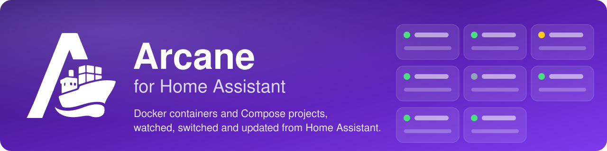
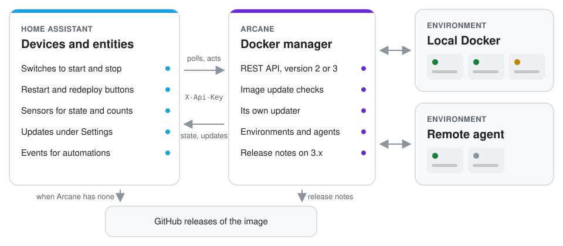
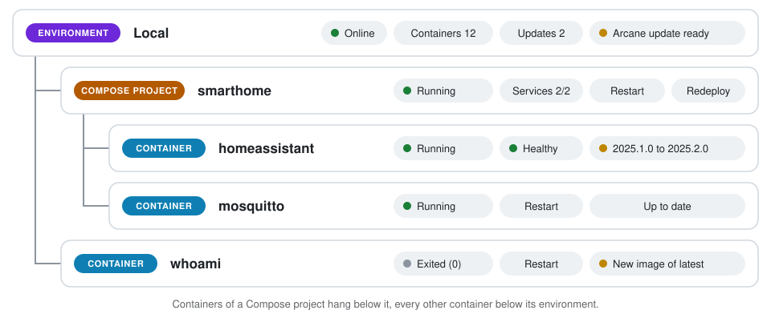
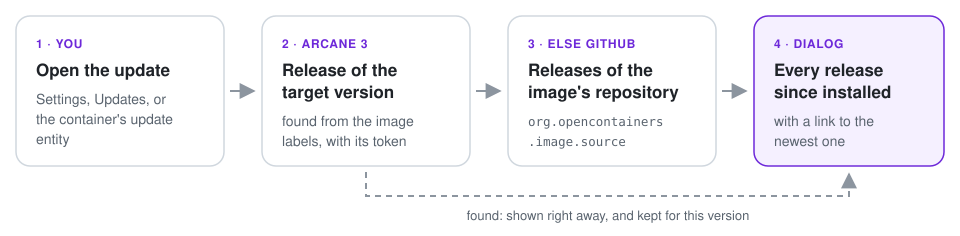

<p align="center">
  
</p>

<p align="center">
  <a href="https://hacs.xyz"></a>
  <a href="https://github.com/ProfessorQuantumUniverse/Arcane-HA/releases"></a>
  <a href="https://github.com/ProfessorQuantumUniverse/Arcane-HA/actions/workflows/validate.yml"></a>
  <a href="https://github.com/ProfessorQuantumUniverse/Arcane-HA/actions/workflows/tests.yml"></a>
  <a href="LICENSE"></a>
</p>

<!-- INSTALL BUTTONS START -->
<p align="center">
  <a href="https://my.home-assistant.io/redirect/config_flow_start/?domain=arcane"></a>
</p>
<!-- INSTALL BUTTONS END -->

Watch and control your Docker containers and Compose projects from Home Assistant,
through [Arcane](https://github.com/getarcaneapp/arcane), the modern Docker management
UI.

- **Devices** for every Arcane environment, Compose project and container, nested the
  way your stacks are.
- **Control**: switches to start and stop, buttons to restart and redeploy, and pruning
  of unused images.
- **Updates** under **Settings > Updates**, installed through Arcane's own updater, with
  the release notes of what you are about to install.
- **Automations** on crashes, out of memory kills, health changes and project state.
- **Arcane 2 and 3**, local and remote environments, found out on their own.

## How it works

<p align="center">
  
</p>

The integration talks to Arcane only, never to Docker directly. It polls Arcane's REST
API with an API key, every 30 seconds by default, and sends actions the same way.
Arcane does the work on the host, also on remote agents, so everything Arcane manages
shows up in Home Assistant.

## Install

You need Home Assistant 2025.2 or newer, an Arcane 2 or Arcane 3 instance it can reach,
and an Arcane API key.

**HACS (recommended).** Arcane is in the HACS default store. Open HACS, search for
**Arcane**, download it and restart Home Assistant.

**By hand.** Copy `custom_components/arcane` from the
[latest release](https://github.com/ProfessorQuantumUniverse/Arcane-HA/releases/latest)
into your `config/custom_components/` and restart.

## Set up

1. In Arcane, create an API key under **Settings > API keys**.
2. In Home Assistant, go to **Settings > Devices & services > Add integration** and pick
   **Arcane**, or use the **Add integration** button above.
3. Enter the address of your instance, for example `http://192.168.1.10:3552`, and the
   key.

Use the address Arcane is actually served on. Redirects are deliberately not followed, so
the API key is never handed to another host. If setup complains about a redirect, use the
address it points at. Whether the instance speaks the Arcane 2 or the Arcane 3 API is
found out on its own, also after you upgrade Arcane.

### API key permissions

The integration works out what your setup needs and tells you: open it and choose
**Configure > API key permissions**. Copy that list into the role behind the key under
**Settings > Roles** in Arcane. Turning an option off drops its permissions from the
list.

Only `environments:list` is required. A key without the rest still sets up; the parts it
cannot reach stay empty and actions fail with an error naming the permission. Whenever
Arcane refuses a call, the permission lands in a repair under
**Settings > System > Repairs**, so a key that is too narrow says so.

<details>
<summary>Every permission and what it is for</summary>

| For | Permissions |
| --- | --- |
| Monitoring | `environments:list`, `containers:list`, `projects:list`, `images:list`, `volumes:list`, `networks:list`, `system:read` |
| Control | `containers:start`, `containers:stop`, `containers:restart`, `projects:deploy`, `projects:down`, `projects:restart` |
| Installing container updates | `image-updates:apply` on Arcane 3, `image-updates:check` on Arcane 2 |
| Release notes from Arcane | `image-updates:read`, Arcane 3 only |
| Redeploy buttons | `containers:redeploy` |
| Prune button | `system:prune` |
| Upgrading Arcane itself | `system:upgrade` |

</details>

## Devices and entities

<p align="center">
  
</p>

Containers appear as child devices of their Compose project, and containers and projects
that come and go in Arcane are added and removed while Home Assistant keeps running.

### Environment

| Entity | Type | Notes |
| --- | --- | --- |
| Online | binary sensor | Whether Arcane reaches the environment |
| Containers, running, stopped | sensor | Live counts |
| Container updates available | sensor | Containers with a newer image |
| Unhealthy containers | sensor | Failing health checks |
| Projects, Projects running | sensor | |
| Images, Unused images, Image storage | sensor | |
| Volumes, Unused volumes, Networks | sensor | |
| Arcane | update | Upgrades the Arcane instance itself |
| Host CPU, memory, disk | sensor | Off by default |
| Docker version, Arcane version | sensor | Diagnostic, disabled by default |
| Prune unused | button | Off by default |

### Container

| Entity | Type | Notes |
| --- | --- | --- |
| *(container name)* | switch | Starts and stops it |
| Image update | update | Installs through Arcane's updater |
| Running, Update available | binary sensor | |
| Healthy | binary sensor | Only with a health check defined |
| State, Status | sensor | `running`, `exited`, `paused` and so on |
| Image, Created | sensor | Diagnostic |
| Restart | button | |
| Redeploy | button | Off by default |

### Compose project

| Entity | Type | Notes |
| --- | --- | --- |
| *(project name)* | switch | On runs `up`, off runs `down` |
| Running, Update available | binary sensor | |
| Status | sensor | `running`, `partially running`, `stopped` and so on |
| Services, Services running | sensor | |
| Restart | button | |
| Redeploy | button | Off by default |

## Options

Open the integration and choose **Configure**.

**Polling:** how often Arcane is polled (30 s by default, 10 to 3600), which
environments to follow, and whether containers, Compose projects, resource counts and
host statistics are polled at all. Internal and hidden containers are skipped unless you
ask for them. Switching a part off also stops the API calls behind it, which keeps a big
host manageable.

**Entities:** update entities, health sensors, device name prefixes, nesting containers
under their project, and firing events.

**Control:** whether Home Assistant may control anything at all, plus the redeploy and
prune buttons, which are off by default.

### Device names

A container and a project often share a name, and Home Assistant builds entity IDs from
the device name, so the second one would only get `_2` suffixed IDs. With the prefix on,
you get `Container kopia` and `Project kopia`, so `switch.container_kopia` and
`switch.project_kopia`. Existing entity IDs are never rewritten, so an upgrade keeps
whatever it already has.

## Updates

Container updates and the Arcane instance itself both show up under
**Settings > Updates**, next to core and add-on updates. Installing a container update
runs Arcane's own updater, the same as the update action in the Arcane UI. Installing
the Arcane update asks Arcane to pull its own newer image and restart, so everything
here goes unavailable for a moment.

An entity only appears in that panel while it has an update and can install it, so with
control turned off the entities still report versions but stay out of the way.

### Images pinned to a version

What counts as an update is Arcane's call. By default Arcane watches the tag a container
runs for a new digest, which is how `latest` and other moving tags are updated. For an
image pinned to a version such as `1.2.3`, tell Arcane to follow versions with a label on
the service:

```yaml
services:
  app:
    image: example/app:1.2.3
    labels:
      com.getarcaneapp.arcane.updater.strategy: tag
      # Optional: stay within one major version.
      com.getarcaneapp.arcane.updater.constraint: 1.x
```

Arcane then reports `1.3.0` as the update, and installing it writes the new tag into the
compose file and recreates the container on it.

### Release notes

<p align="center">
  
</p>

The update dialog of a container shows the release notes of what it installs. They are
only fetched when you open the dialog, and kept for that version.

1. **Arcane 3** is asked first. It looks the release up on GitHub from the
   `org.opencontainers.image.source` label of the image, with the GitHub token set in
   Arcane if there is one.
2. When Arcane has nothing, which happens for a new image of `latest` that names no
   version, and always on Arcane 2, the integration reads the releases of that
   repository itself.
3. An update that skips versions shows every release in between, from the installed
   version up. A new image of a moving tag gets the newest release the tag follows:
   `latest` or `stable` the newest stable release, `2` or `1.4` the newest one of that
   line. The dialog says when the notes are matched that way.

Images that name no GitHub repository in their labels, such as official Docker Hub
images like `nginx`, have no release notes. GitHub allows 60 anonymous requests per
hour, which is plenty for opening update dialogs. Every container update also links to
its release, or to the releases page of the repository.

## Events

With events on, these fire on the bus and work as automation triggers:

| Event | Data |
| --- | --- |
| `arcane_container_state_changed` | `container`, `state`, `previous_state`, `exit_code`, `crashed`, `oom_killed`, `environment`, `environment_id` |
| `arcane_container_health_changed` | `container`, `health`, `previous_health`, `environment`, `environment_id` |
| `arcane_project_state_changed` | `project`, `project_id`, `status`, `previous_status`, `environment`, `environment_id` |

`crashed` means a running container stopped with a non zero exit code, and `oom_killed`
narrows that to exit code 137, the fingerprint of an out of memory kill. Nothing fires
for the first update after a restart or for a container that has just appeared.

```yaml
automation:
  - triggers:
      - trigger: event
        event_type: arcane_container_state_changed
        event_data:
          crashed: true
    actions:
      - action: notify.mobile_app
        data:
          message: "{{ trigger.event.data.container }} crashed with exit code {{ trigger.event.data.exit_code }}"
```

## Good to know

**Pruning** removes unused images, unused networks and the build cache. Containers and
volumes are never touched, because both hold state you cannot pull back. The option picks
how far it goes: no button at all, dangling images only, or every unused image. A button
in Home Assistant has no confirmation dialog, so leave it off unless you want one press
to act immediately.

**Host statistics** are off by default. Arcane only offers them over a WebSocket and
sends the current sample right after the handshake, so the integration opens a socket,
takes one sample per update and closes it again. Per container CPU and memory are not
available: Arcane wants one socket per container and refuses more than five at a time.

**Security.** The API key travels in the `X-Api-Key` header, never in a URL, and is
redacted from diagnostics. Only `http://` and `https://` addresses are accepted, and
addresses carrying credentials are rejected because they end up in log lines. Redirects
are not followed. You can switch certificate verification off for a self signed
certificate, but Home Assistant will warn at startup, so prefer a trusted certificate or
plain HTTP on a network you control. The only other host the integration talks to is
`api.github.com`, without credentials, for release notes.

**Behaviour.** Every selected environment is polled, remote agents included; one that is
unreachable reports as offline instead of failing the whole update. Container entities
are keyed by name, so they survive a redeploy that changes the container ID. Stopping a
project runs `down`, which removes its containers, so those entities disappear until it
is deployed again. A health sensor is added when the container reports a health check at
the moment it is discovered; one that gains a check later picks it up after a reload.

## Development

```bash
python -m venv .venv
.venv/bin/pip install -r requirements_test.txt
.venv/bin/python -m pytest
```

Home Assistant's test harness needs Linux or macOS; on Windows, run the tests in WSL or
a `python:3.13` container.

### Releasing

The version lives in `custom_components/arcane/manifest.json` and HACS reads it from
there. A release is that version, tagged:

1. Bump `version` in the manifest and add the matching `## X.Y.Z` section to
   `CHANGELOG.md`.
2. Run `python scripts/release.py check vX.Y.Z` to confirm the three agree.
3. Merge, then push the tag. The release workflow rechecks, runs the tests and publishes
   the GitHub release with that changelog section as its notes.

HACS installs the newest published release, so a tag that was never released stays
invisible.
